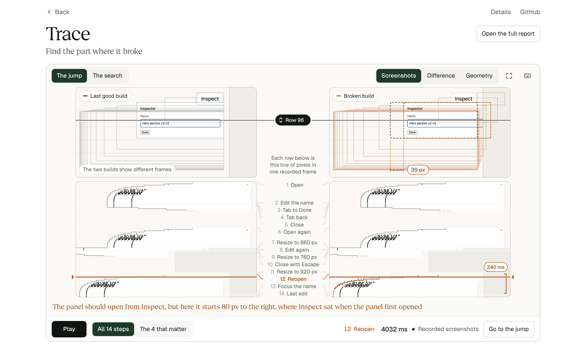

# Trace

Trace replays the same user actions on two builds of a React component, checks what
must stay true, and shrinks a failure to the few actions that cause it.

A panel can look right in its final screenshot and still have lost focus, accepted a
stale transition or jumped during a resize. Trace finds those failures and explains
each one in a sentence, with two aligned replays that show where the builds part.



## See a report

**[Watch the replay](https://www.qendrimbeka.com/projects/trace/index.html)** in your browser. It plays one failure on two builds, and links to the
full report. No install needed. The same page is in the repository at
[demo/index.html](demo/index.html).

In the full report, `Space` plays, `[` and `]` step by action, `F` jumps to the failure, and
`R` switches between the reduced and original sequence.

You can also watch the [20 second demo](docs/assets/trace-demo.mp4) or the
[67 second walkthrough](docs/assets/trace-walkthrough.mp4), which has captions and no voice.

## Run it

You need Node 22.16 or later and pnpm.

```bash
pnpm install
```

```bash
pnpm exec playwright install chromium firefox webkit
```

```bash
pnpm build
```

Run one session on a good build and a broken one.

```bash
pnpm trace run fixtures/inspector/scenarios/long-session.json --baseline inspector@correct --candidate inspector@stale-origin --out .trace/demo
```

```text
REGRESSION: panel appeared 80 px away from trigger at 4000 ms. It should start at trigger or at its final position.
Report: .trace/demo/report/index.html
```

Shrink the failure to the actions that cause it. This takes about a minute.

```bash
pnpm trace reduce .trace/demo
```

```text
REDUCED: 14 actions to 4, in 26 attempts and 61.2 s.
Reproduced in 10 of 10 runs. Baseline showed it in 0 of 3.
```

Open the report at <http://127.0.0.1:5175>.

```bash
pnpm trace serve .trace/demo/report
```

## Use it on your component

1. Add `data-trace-id` to the elements you care about, and set `window.__traceFixture` on a
   test page so Trace can read your component's state.
2. Write a scenario: what the user does, and what must stay true.
3. Add both builds to a fixture manifest, then register it with `pnpm trace fixtures add path/to/fixture.json`.
4. Run `pnpm trace run my.scenario.json --baseline tabs@main --candidate tabs@branch`.

A scenario looks like this. Requirements live in the scenario, not in a baseline, so a bug
both builds share still fails.

```json
{
  "schema": "trace.scenario/1",
  "id": "reopen-during-close",
  "fixture": { "id": "inspector", "version": "1" },
  "seed": 1,
  "initialState": {},
  "viewport": { "width": 900, "height": 640, "deviceScaleFactor": 1 },
  "timing": { "mode": "controlled", "stepMs": 16, "settleMs": 500 },
  "targets": {
    "trigger": { "role": "button", "name": "Inspect", "traceId": "trigger" },
    "close": { "role": "button", "name": "Done", "traceId": "close" }
  },
  "requirements": [
    { "kind": "latest-request-wins", "key": "panel", "terminal": ["open", "closed"] },
    { "kind": "focus-valid" }
  ],
  "actions": [
    { "at": 0, "type": "activate", "target": "trigger", "requests": { "panel": "open" } },
    { "at": 400, "type": "activate", "target": "close", "requests": { "panel": "closed" } },
    { "at": 500, "type": "activate", "target": "trigger", "requests": { "panel": "open" } }
  ],
  "cleanup": []
}
```

[docs/SCENARIOS.md](docs/SCENARIOS.md) covers every action, every requirement and fixture
registration.

## What a run tells you

| Verdict | Meaning | Exit code |
|---|---|---|
| `pass` | Both builds met every requirement the run reached. The report lists any it did not reach. | 0 |
| `fixed` | The baseline failed and the candidate does not | 0 |
| `regression` | The candidate breaks a requirement the baseline meets | 1 |
| `shared-failure` | Both builds break the same requirement | 1 |
| `invalid` | The scenario cannot run on the baseline | 2 |
| `diverged` | It ran on the baseline and could not finish on the candidate | 2 |

A failed selector, an unsupported command, a state key the page never publishes, or a
press that lands off target is never reported as a regression.

## Results

Measured on one Apple M5 Pro Mac, on a corpus I wrote. These counts describe that corpus.
They are not an accuracy claim about other code.

| Detector | Tuned corpus: seeded bugs caught | Tuned corpus: clean builds flagged | Holdout fixture: seeded caught | Holdout fixture: clean flagged |
|---|---|---|---|---|
| **Trace** | 18 of 18 | 0 of 13 | 6 of 6 | 1 of 4 |
| Any recorded difference (control) | 18 of 18 | 9 of 13 | 6 of 6 | 2 of 4 |
| Final screenshot difference (control) | 11 of 18 | 5 of 13 | 2 of 6 | 0 of 4 |

So Trace does not find more of these bugs than comparing two full traces. Its requirements
reject most legitimate changes, and they can fail a bug both builds share, which no
comparison can.

| Measurement | Result |
|---|---|
| Browsers | Same tuned result on Chromium, Firefox and WebKit |
| Random sessions on correct builds | 300 seeded, 295 completed, 2 flagged. Both are a real bug in my own fixture. |
| Reduction | 18 actions to 2 on 3 generated sessions, 14 to 4 on a written one. Reproduced in 10 of 10 fresh runs, 0 of 3 on the baseline. |
| Recording cost | 60 ms more main thread work across a 14 action, 5.4 s scenario. 46 to 60 ms across 3 runs. |

The full method, raw runs and failures are in [docs/REPORT.md](docs/REPORT.md).

## Limits

- **The corpus is small and I wrote it.** The 18 of 18 is tuned: the first run caught 12.
- **The holdout ran once, on an earlier oracle.** No result tests the final oracle on unseen code.
- **Trace only finds what a scenario reaches.** A requirement never reached says `not exercised`.
- **Controlled time has gaps.** Each run lists what it does not hold.
- **Nobody else has used it.**

[docs/LIMITS.md](docs/LIMITS.md) has the complete list.

## Commands

| Command | What it does | Time here |
|---|---|---|
| `pnpm check` | Type checks everything | Under 1 s |
| `pnpm test` | 125 unit tests | Under 1 s |
| `pnpm test:e2e` | 71 real browser tests on all three engines | About 5 minutes |
| `pnpm bench:smoke` | One good pair and one seeded failure | About 4 s |
| `pnpm bench` | The full measurement | 42 minutes |
| `pnpm demo` | Rebuilds the reports and project page in `demo/` | About 80 s |
| `pnpm page` | Rebuilds only the project page, from `site/` | Under 1 s |
| `pnpm verify:artifacts` | Checks saved results against their hashes | Under 1 s |

## How it works

```
scenario.json ──> runner ──> two browsers, one action list
                    │           └─ recorder (in the page, outside React)
                    │                focus, geometry, state, events, resources
                    v
              trace events ──> oracle ──> violations ──> verdict
                    │                                      │
                    v                                      v
                 raw files ──> report export          reducer (deletes actions,
                                 static folder         keeps the failure fixed)
```

| Path | Role |
|---|---|
| `src/scenario` | The versioned format and checks that need no browser |
| `src/recorder` | Runs in the page. It keeps no text or input values |
| `src/runner` | Clock, input, build serving, run manifest |
| `src/oracle` | Pure functions from a scenario and one trace to violations |
| `src/reduce` | Bounded delta debugging, then the browser predicate |
| `src/report`, `viewer` | Portable report and the case file viewer |
| `site` | The project page, built from saved runs |
| `fixtures` | Four fixture families with seeded and legitimate variants |
| `corpus` | Expected labels for each build |
| `bench`, `results` | Reproducible measurements and raw data |

Design choices are in [docs/DESIGN.md](docs/DESIGN.md), the primary sources in
[docs/RESEARCH.md](docs/RESEARCH.md), and the frozen plan in
[docs/MEASUREMENT.md](docs/MEASUREMENT.md).

Trace does not check out repositories, run remote code or test sites off this machine.
`trace.fixtures.json` can name build commands, so treat it like code in the repository you
run Trace from. Reports include a scenario's typed text and screenshots, so use synthetic data.

Trace is not a general test runner, and it does not replace Playwright Trace Viewer. It
adds requirements, comparison and reduction for interrupted interactions.

## License

MIT for the code in this repository. Bundled fonts and dependencies keep their own
licenses. See [ATTRIBUTION.md](ATTRIBUTION.md).
